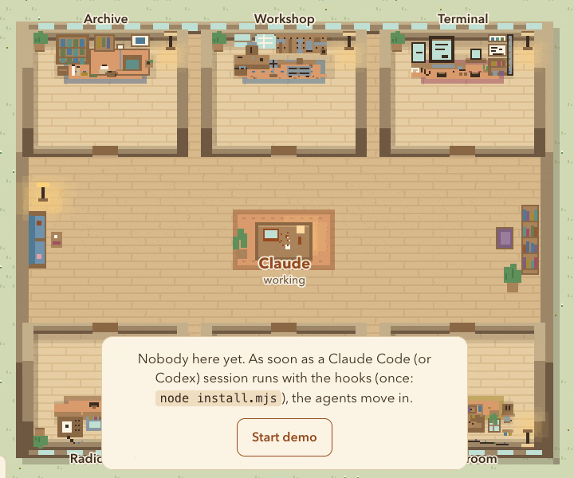
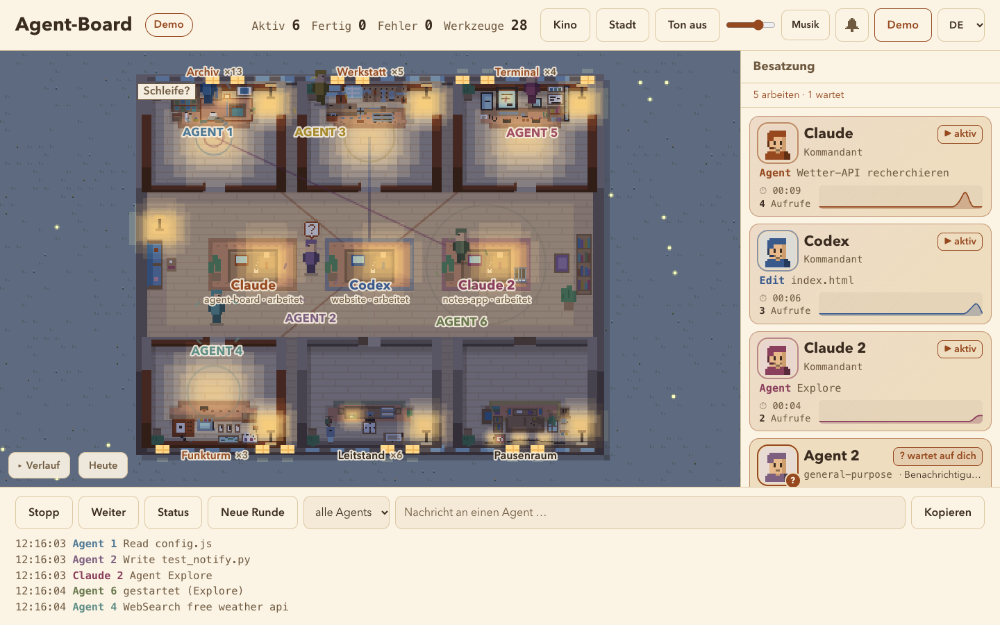
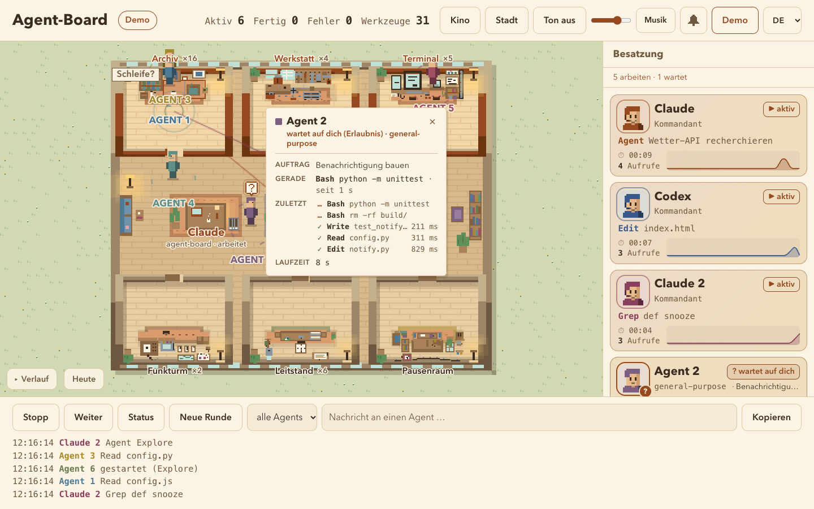

# Agent-Board

**Eine gemütliche Pixel-Art-Live-Ansicht deiner Claude-Code-Agents.**

Claude sitzt am Schreibtisch im Wohnzimmer einer kleinen Wohnung, von oben gesehen. Jeder Subagent ist eine kleine Pixel-Figur, die je nach Werkzeug durch eine Tür in ihr Zimmer geht. Die Tür gleitet auf, und du siehst auf einen Blick, wer arbeitet, wer fertig ist, wer hängt und wer auf dich wartet.

[English version → README.md](README.md)



**[▶ Live-Demo im Browser ausprobieren](https://stefan-paun.github.io/agent-board/?demo=1&lang=de)** (ohne Installation, simulierte Runde)

- Keine Abhängigkeiten, kein Build: nur Node und eine HTML-Seite mit Canvas und WebAudio.
- Die Oberfläche gibt es auf Deutsch, Englisch und Spanisch, sie folgt der Browsersprache. Umschalten mit der Sprachwahl oben in der Kopfzeile (oder `?lang=de`, `?lang=en`, `?lang=es`), die Wahl wird gemerkt. Eine weitere Sprache ist eine zusätzliche Spalte in [`public/i18n.js`](public/i18n.js).
- Gespeist aus [Claude-Code-Hooks](https://docs.claude.com/en/docs/claude-code/hooks) (und experimentell aus Codex-Hooks); alles bleibt auf deinem Rechner.

## Was du siehst

| | |
|---|---|
| **Zimmer = Werkzeuge** | Archiv (Read/Grep/Glob), Werkstatt (Edit/Write), Terminal (Bash), Funkturm (Web), Leitstand (alles andere). Fertige Agents gehen in den Pausenraum. |
| **„Wartet auf dich“** | Braucht ein Agent eine Erlaubnis, kommt er mit einer `?`-Blase zu Claudes Tisch. Sanfter Gong, `(?)` im Tab-Titel, auf Wunsch eine Browser-Benachrichtigung. |
| **Hängt? / Schleife?** | Abzeichen, wenn ein Werkzeug ungewöhnlich lange läuft oder ein Agent dasselbe immer wieder macht. Mit der Maus darüber siehst du den Grund, ein Klick kopiert einen Hinweis für den Chat. |
| **Rate-Limit** | Ein Holzschild „Pause bis 18:45“ neben Claudes Tisch. |
| **Papierkorb** | Füllt sich mit dem Kontext und wird beim Komprimieren ausgeleert. |
| **Tag & Nacht** | Nach deiner echten Uhrzeit: nachts warme Lampen und Glühwürmchen, zur vollen Stunde ein leiser Gong. |
| **Info-Karte** | Klick auf eine Figur: Auftrag, aktuelles Werkzeug, letzte 5 Schritte mit Dauer, Laufzeit. |
| **Verlauf & Zusammenfassung** | Einklappbare Zeitleiste aller Werkzeugaufrufe und eine Karte „Runde fertig“ zum Kopieren, wenn Claude stoppt. |
| **Ton** | Eigene Klänge pro Zimmer mit Varianten und Stereo, dazu optional Lo-Fi-Musik. Aus, bis du ihn einschaltest. |

<p>
  
  
</p>

## Schnellstart

Braucht Node 20+ auf macOS, Linux oder Windows (unter Windows führt Claude Code Hooks über die Git Bash aus, die bei [Git für Windows](https://git-scm.com/download/win) dabei ist) und ein aktuelles Claude Code (getestet mit 2.1.295; ältere Versionen kennen Ereignisse wie `StopFailure` oder `PostCompact` evtl. nicht).

```bash
git clone https://github.com/Stefan-Paun/agent-board.git
cd agent-board
npm start                 # http://localhost:4777
```

<http://localhost:4777/?demo=1> zeigt sofort eine simulierte Runde, ganz ohne Einrichtung.

### Mit Claude Code verbinden

```bash
node install.mjs --dry-run   # zeigt, was sich ändern würde
node install.mjs             # trägt Hooks + Statusline in ~/.claude/settings.json ein (mit Sicherungskopie)
```

Das Skript trägt pro Ereignis einen asynchronen Hook ein (Claude Code wartet nie darauf), lässt deine anderen Hooks stehen und reicht eine vorhandene Statusline weiter. Neue Sessions melden sich sofort, in einer laufenden einmal `/hooks` öffnen.

**Update von 1.0?** Einfach `node install.mjs` noch einmal ausführen: Es ersetzt die alten `hook.sh`-/`statusline.sh`-Einträge durch die neuen, die `node` direkt aufrufen.

Entfernen: `node install.mjs --uninstall`. Lieber von Hand? Siehe [`docs/hooks-snippet.json`](docs/hooks-snippet.json).

### Mit Codex verbinden (experimentell)

[Codex](https://github.com/openai/codex) hat [Hooks](https://learn.chatgpt.com/docs/hooks) im gleichen Format, deshalb kann das Board es auch anzeigen:

```bash
node install.mjs --codex --dry-run   # zeigt, was sich ändern würde
node install.mjs --codex             # trägt Hooks in ~/.codex/hooks.json ein (bzw. $CODEX_HOME), mit Sicherungskopie
```

Codex führt neue Hooks erst nach einer Freigabe aus: In Codex einmal `/hooks` öffnen und die Agent-Board-Einträge erlauben. Codex bekommt neben Claude einen eigenen Schreibtisch (blau, rechts) als zweiter Kommandant, mit eigener Besatzungskarte, eigener Zeile im Verlauf und eigenem „Wartet auf dich“; läuft nur Codex, sitzt es allein in der Mitte. Shell-Befehle landen im *Terminal*, `apply_patch`-Änderungen in der *Werkstatt* (mit Dateinamen), gestartete Agents werden zu Subagents. Eine Statusline hat Codex nicht, Kontext-%, Kosten und Limits bleiben also leer. Entfernen: `node install.mjs --codex --uninstall`.

## Demo-Schalter

| URL | |
|---|---|
| `?demo=1` | simulierte Runde mit 4 Agents, Erlaubnis-Anfrage, Schleife und Kompaktierung |
| `&codex=1` | Codex arbeitet gleichzeitig am zweiten Schreibtisch |
| `&multi=1` | Codex und eine zweite Claude-Session: drei Schreibtische |
| `&ratelimit=1` | zusätzlich ein Rate-Limit |
| `&hang=8` | „Hängt?“ schon nach 8 s |
| `&hour=22` | Tageszeit erzwingen (0–24) |
| `&lang=en` | englische Oberfläche (`es` Spanisch, `de` Deutsch) |

## Einstellungen

| Variable | Standard | |
|---|---|---|
| `AGENT_BOARD_PORT` | `4777` | Port |
| `AGENT_BOARD_DATA` | `~/.local/share/agent-board` | Datenordner (`events.jsonl`, `status.json`, `subagents.json`) |
| `AGENT_BOARD_ALLOW_HOST` | leer | zusätzlich erlaubte Host-Namen, kommagetrennt (z.B. für Tailscale) |

Am Handy zuschauen: [docs/IPHONE.de.md](docs/IPHONE.de.md).

## Datenschutz

Alles bleibt lokal. Der Server bindet nur an `127.0.0.1`, lehnt fremde `Host`-Header ab und schickt eine strenge Content-Security-Policy.

Der Collector speichert je Ereignis nur: Zeit, Ereignisart, gekürzte Session- und Agent-ID, Agent-Typ, Projektordner-Name, Werkzeugname und ein gekürztes Ziel (Dateiname ohne Pfad, Anfang eines Befehls, Suchmuster, Hostname), dazu kurze Zusatzfelder: Tool-Use-ID, Dauer, Art und Text einer Benachrichtigung, Fehlerart, Aufgabentitel, den Grund einer abgelehnten Erlaubnis und die ersten 80 Zeichen von Claudes letzter Antwort (die deine Frage zitieren können). Die Datei hat Rechte 600 und ist auf ca. 5 MB begrenzt. Mit Statusline enthält `status.json` Kontext-Prozent, Kosten, Modell und Limits, `subagents.json` je Subagent Kurzbeschreibung, Status, Token und Modell.

**Nie gespeichert:** Prompt-Texte (nur deren Länge), Werkzeug-Ausgaben, Fehlertexte, Kompaktierungs-Zusammenfassungen. Geheimnisse werden vor dem Schreiben unkenntlich gemacht: lange schlüsselartige Folgen, bekannte Schlüssel-Präfixe (`sk-…`, `ghp_…`, `AKIA…`), Zuweisungen wie `*_TOKEN=` / `*_PASSWORD=`, Optionen wie `-p…`/`--password`, `user:pass@` in Adressen und `Bearer`-Header. Das ist nach bestem Bemühen – das Board ist für den eigenen Rechner gedacht.

## Grenzen

- Beobachten, nicht steuern: Die Knöpfe kopieren Text, den du im Chat einfügst.
- Windows wird bei jedem Push automatisch getestet (auch die eingetragenen Befehle über die Git Bash), wurde aber noch nicht mit Claude Code auf einem echten Windows-PC ausprobiert. Rückmeldungen willkommen.
- Jede Session bekommt ihren eigenen Schreibtisch („Claude“, „Claude 2“, „Codex“ …, darunter der Projektordner). Ins Wohnzimmer passen 4; bei mehr Sessions bekommen die 4 zuletzt aktiven einen Tisch, die übrigen stehen nur in der Besatzungsliste. Ein Tisch wird eine Minute nach `SessionEnd` oder nach 45 Minuten ohne Ereignis geräumt.
- Es gibt nur eine Statusline-Datei: Kontext-%, Kosten und Limits gehören immer zur zuletzt aktiven Claude-Session.
- Die Codex-Unterstützung ist nach der offiziellen Hook-Doku gebaut und mit nachgebauten Ereignissen getestet, aber noch nicht mit einer echten Codex-Session. Gehostete Codex-Werkzeuge wie die Websuche senden keine Hooks und tauchen daher nicht auf.

## Entwicklung

```bash
npm test
npm run test:browser   # Smoke-Test der Oberfläche in headless Chrome (Node 22+, ohne Chrome übersprungen; sonst CHROME_PATH setzen)
```

Erweiterungen hängen sich über eine kleine Schnittstelle in den Kern, siehe [docs/FX-API.md](docs/FX-API.md).

## Kein offizielles Produkt

Agent-Board ist ein unabhängiges Hobbyprojekt und steht in keiner Verbindung zu Anthropic oder OpenAI. „Claude“ und „Claude Code“ sind Marken von Anthropic, „Codex“ ist eine Marke von OpenAI; sie werden hier nur verwendet, um zu beschreiben, womit das Werkzeug arbeitet.

## Lizenz

[MIT](LICENSE)
