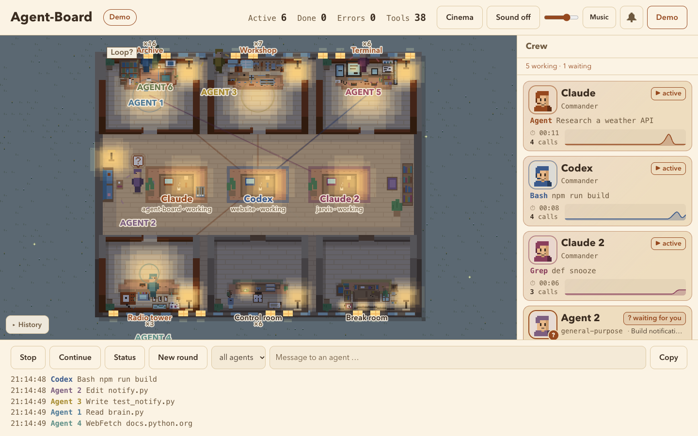
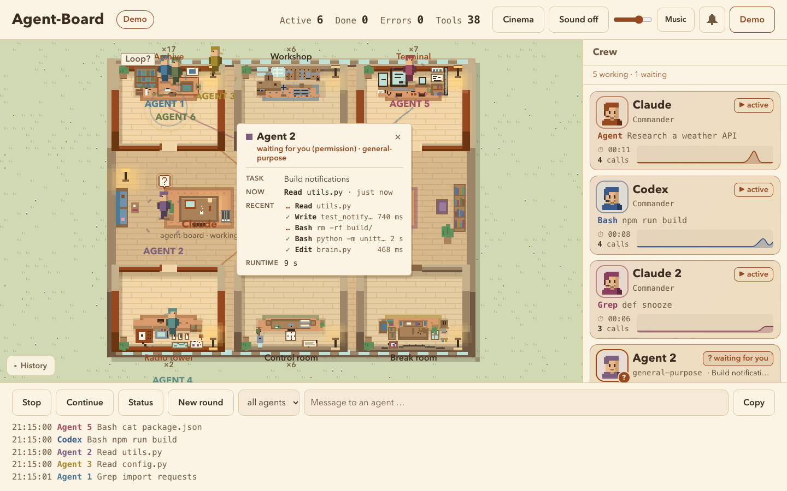
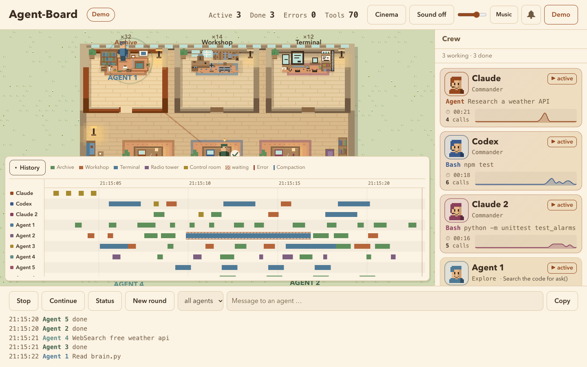
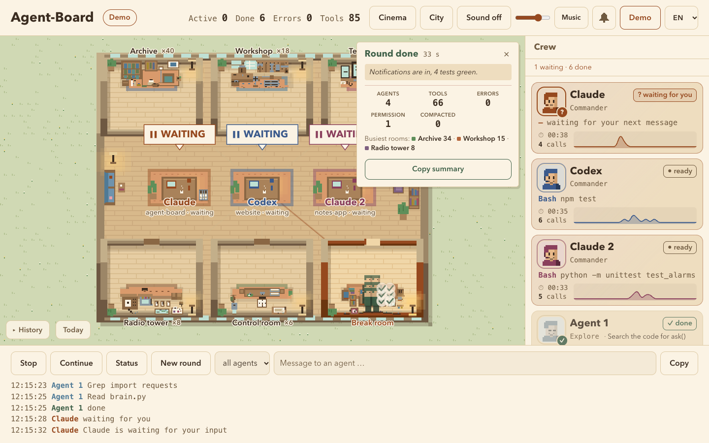
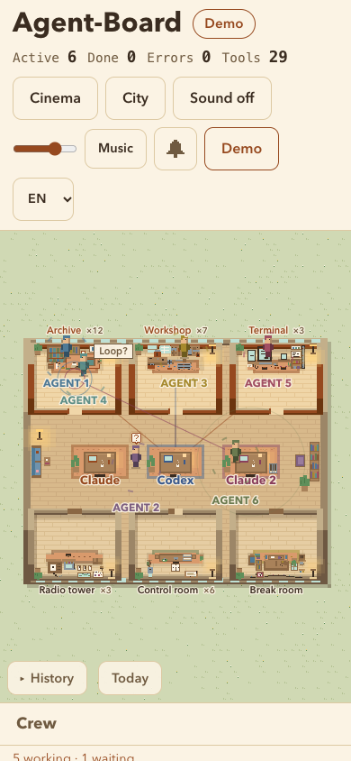

# Agent-Board

**A cozy pixel-art live view of your Claude Code agents.**

Claude sits at a desk in the living room of a little top-down apartment. Every subagent is a tiny pixel person who walks through a door into the room that matches the tool it is using, the door slides open, and you see at a glance who is working, who is done, who is stuck, and who is waiting for you.

[Deutsche Version → README.de.md](README.de.md)


**[▶ Try the live demo in your browser](https://stefan-paun.github.io/agent-board/?demo=1)** (no install, simulated session)

- Zero dependencies, no build step: plain Node + one HTML page with Canvas and WebAudio.
- Fed by [Claude Code hooks](https://docs.claude.com/en/docs/claude-code/hooks) (and, experimentally, Codex hooks); everything stays on your machine.
- The UI speaks English, German and Spanish and follows your browser language. Switch it with the language picker in the header (or `?lang=en`, `?lang=de`, `?lang=es`); the choice is remembered. Adding a language is one more column in [`public/i18n.js`](public/i18n.js).

## What you see

| | |
|---|---|
| **Rooms = tools** | Archive (Read/Grep/Glob), Workshop (Edit/Write), Terminal (Bash), Radio tower (Web), Control room (everything else). Finished agents go to the Break room. |
| **"Waiting for you"** | When an agent needs a permission, it walks over to Claude's desk with a `?` bubble. Soft chime, `(?)` in the tab title, optional browser notification. |
| **Stuck? / Loop?** | Badges when a tool runs unusually long or an agent repeats the same call. Hover for the reason, one click copies a hint you can paste into the chat. |
| **Rate limit** | A little wooden "Paused until 18:45" sign next to Claude's desk. |
| **Context bin** | A wastebasket next to the desk fills up with your context window and gets emptied on compaction. |
| **Day & night** | Follows your real clock: warm lamps and fireflies at night, a quiet chime on the hour. |
| **Info card** | Click any figure: its task, current tool, last 5 steps with duration, runtime. |
| **Timeline & summary** | A collapsible timeline of every tool call per agent, and a "Round done" card with a copyable summary when Claude stops. |
| **Day summary** | The "Today" button: active time per commander (Claude, Codex, Claude 2 …), rounds, agents and the tools used today, counted from the event log the board already keeps. |
| **Sound** | Per-room synthesized sounds with variations and stereo panning, plus optional lo-fi music. Off until you turn it on. |

<p>
  
  
</p>
<p>
  
  
</p>

## Quick start

Requires Node 20+ on macOS, Linux or Windows (on Windows, Claude Code runs hooks through Git Bash, which comes with [Git for Windows](https://git-scm.com/download/win)) and a recent Claude Code (tested with 2.1.295; older versions may not know events like `StopFailure` or `PostCompact`).

```bash
git clone https://github.com/Stefan-Paun/agent-board.git
cd agent-board
npm start                 # http://localhost:4777
```

Open <http://localhost:4777/?demo=1> to see a simulated session right away, no setup needed.

### Connect Claude Code

```bash
node install.mjs --dry-run   # show what would change
node install.mjs             # add hooks + status line to ~/.claude/settings.json (backup is made)
```

The installer adds one async hook entry per event (Claude Code never waits for it), keeps all your other hooks, and keeps an existing status line by passing its output through. New Claude Code sessions report to the board immediately; in a running session open `/hooks` once.

**Upgrading from 1.0?** Run `node install.mjs` again: it replaces the old `hook.sh` / `statusline.sh` entries with the new ones that call `node` directly.

Remove it again with `node install.mjs --uninstall`. Prefer to edit by hand? See [`docs/hooks-snippet.json`](docs/hooks-snippet.json).

### Connect Codex (experimental)

[Codex](https://github.com/openai/codex) has [hooks](https://learn.chatgpt.com/docs/hooks) in the same format, so the board can show it too:

```bash
node install.mjs --codex --dry-run   # show what would change
node install.mjs --codex             # add hooks to ~/.codex/hooks.json (or $CODEX_HOME), backup is made
```

Codex only runs new hooks after you trust them: open `/hooks` in Codex once and allow the Agent-Board entries. Codex gets its own desk next to Claude's (blue, on the right) as a second commander, with its own crew card, timeline row and "waiting for you" badge; if only Codex is running it sits alone in the middle. Shell commands go to the *Terminal*, `apply_patch` edits to the *Workshop* (with the file names), spawned agents become subagents. Codex has no status line, so context %, cost and limits stay empty. Remove with `node install.mjs --codex --uninstall`.

## Demo switches

| URL | |
|---|---|
| `?demo=1` | simulated session with 4 agents, a permission request, a loop and a compaction |
| `&codex=1` | Codex works at a second desk at the same time |
| `&multi=1` | Codex plus a second Claude session: three desks |
| `&ratelimit=1` | adds a rate-limit stop |
| `&hang=8` | "Stuck?" threshold of 8 s instead of minutes |
| `&hour=22` | force a time of day (0–24) |
| `&lang=de` | German UI (`es` Spanish, `en` English) |

## Configuration

| Variable | Default | |
|---|---|---|
| `AGENT_BOARD_PORT` | `4777` | port |
| `AGENT_BOARD_DATA` | `~/.local/share/agent-board` | data folder (`events.jsonl`, `status.json`, `subagents.json`) |
| `AGENT_BOARD_ALLOW_HOST` | empty | extra allowed host names, comma separated (e.g. for Tailscale) |

Watching from your phone: [docs/IPHONE.md](docs/IPHONE.md) (Tailscale HTTPS + add to home screen).



## Privacy

Everything stays local. The server binds to `127.0.0.1` only, rejects foreign `Host` headers and sends a strict Content-Security-Policy.

The collector stores per event only: time, event type, shortened session/agent IDs, agent type, project folder name, tool name and a shortened target (file name without path, start of a command, search pattern, host name), plus short extra fields: tool-use ID, duration, notification type and text, error type, task title, the reason of a denied permission, and the first 80 characters of Claude's final reply (which can quote what you asked). The file is `chmod 600` and capped at about 5 MB. With the status line installed, `status.json` holds context %, cost, model and limits, and `subagents.json` each subagent's short description, status, token count and model.

**Never stored:** prompt text (only its length), tool output, error messages, compaction summaries. Secrets are redacted before anything is written: long token-like strings, known key prefixes (`sk-…`, `ghp_…`, `AKIA…`), `*_TOKEN=` / `*_PASSWORD=` style assignments, `-p…`/`--password` options, `user:pass@` in URLs and `Bearer` headers. Redaction is best effort, so the board is meant for your own machine.

## How it works

```
Claude Code ──hooks──────▶ node collector.mjs ───────▶ events.jsonl ─┐
            ──statusline─▶ node statusline.mjs ──────▶ status.json  ─┤
Codex       ──hooks──────▶ node collector.mjs codex ─▶ events.jsonl ─┤
                                                                     ▼
                              browser ◀──SSE── server.mjs (127.0.0.1)
```

The page renders the whole scene into a small low-resolution buffer and scales it up with nearest-neighbor, so the art stays truly pixelated while text stays crisp. Features live in small modules under `public/fx/` that hook into the core through a tiny API, see [docs/FX-API.md](docs/FX-API.md).

## Limits

- It observes, it does not control: the buttons copy text for you to paste into the chat.
- Windows is covered by automated tests on every push (including running the installed commands through Git Bash), but has not been tried with Claude Code on a real Windows PC yet. Feedback welcome.
- Every session gets its own desk ("Claude", "Claude 2", "Codex" …, with the project folder underneath). Up to 4 desks fit in the living room; with more sessions the 4 most recently active get one and the rest are listed in the crew panel only. A desk is cleared a minute after `SessionEnd` or after 45 minutes without events.
- There is only one status line file, so context %, cost and limits always belong to the most recently active Claude session.
- Codex support is built from the official hook documentation and tested with recorded-style events, but not yet with a real Codex session. Hosted Codex tools such as web search send no hooks, so they do not show up.

## Development

```bash
npm test
```

## Not affiliated

Agent-Board is an independent hobby project and is not affiliated with or endorsed by Anthropic or OpenAI. "Claude" and "Claude Code" are trademarks of Anthropic, "Codex" is a trademark of OpenAI; they are used here only to describe what the tool works with.

## License

[MIT](LICENSE)
