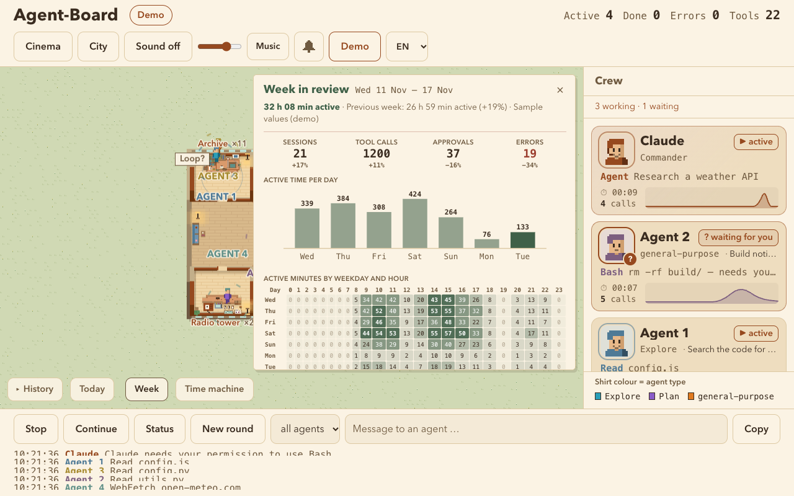
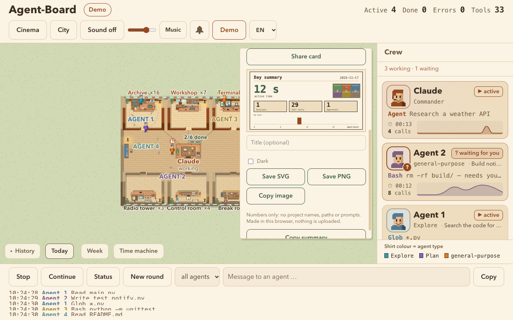
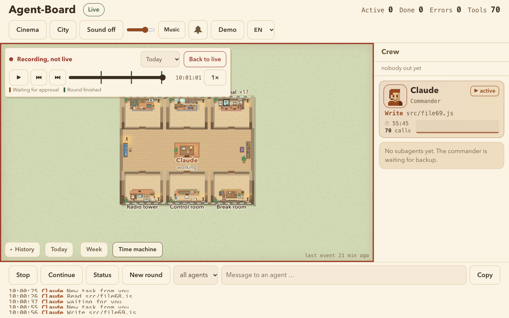
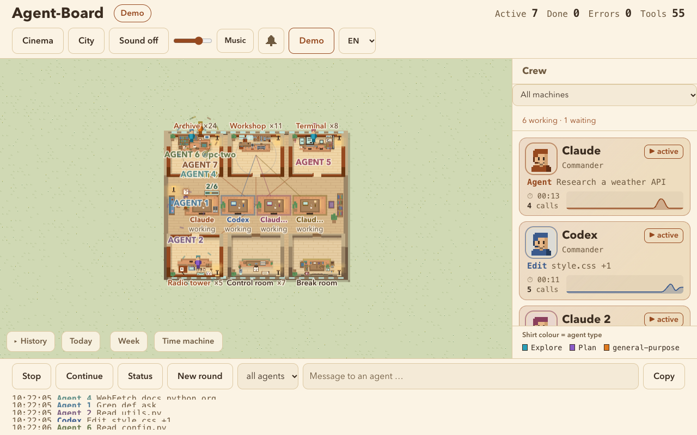

# Agent-Board 1.7.0

Look back, share, and watch from a second computer.

## Highlights

- **Time machine**: replay the last hour, today or yesterday on the board, with speeds 1x/10x/60x and marks for approvals and finished rounds. Live events are held back while you watch a recording.
- **Week in review**: the "Week" button (key `W`) shows up to 7 days of active time, tool calls, approvals and errors, an hour heatmap and your most used tools (limited to the ~48 h the log keeps).
- **Share card**: turn the day summary into a 1200 x 630 card (numbers only, no project names or paths) and save it as SVG or PNG.
- **Second machine**: agents from another computer appear on the same board with an `@name` badge and a filter. Opt-in and token-protected.






## Also new

- Read-only access from LAN or Tailscale (opt-in via `AGENT_BOARD_BIND` and `AGENT_BOARD_HOSTS`).
- Configurable desk timeout (`AGENT_BOARD_IDLE_MINUTES`) and "last seen" on idle desks.
- Task board at the main figure's desk in the city view.
- Screen readers announce waiting, resumed and failed states.
- The empty-state card shows the doctor result.

## Fixes and internals

- Desk labels no longer overlap with three desks; the map re-measures on resize.
- `events.jsonl` keeps 48 hours on rotation; replay and `/health` read only the log tail.
- A readable message when the port is taken or invalid.
- `install.mjs --gemini --doctor` checks the right setup.
- Service worker cache lists come from one source (cache v9).

## Upgrade

```bash
git pull
npm test          # optional
node install.mjs  # only if you want to refresh the hooks
```

Restart the board. No configuration changes are needed; all new features are read-only or opt-in. Full history: [CHANGELOG.md](../CHANGELOG.md).
